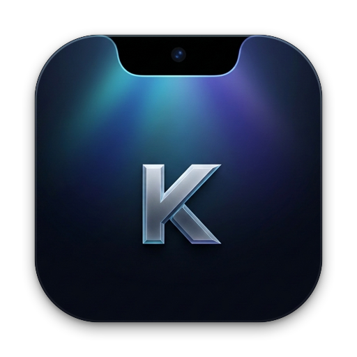
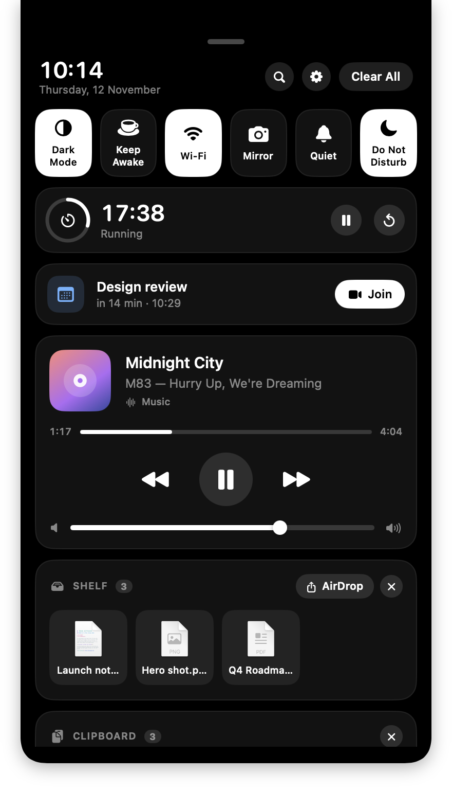

<div align="center">
  
  <h1>KramaIsland</h1>
  <p><strong>A native, 120 fps Dynamic Island for macOS — media, volume, window tiling, notifications, clipboard &amp; launcher in one seamless obsidian surface.</strong></p>

  <p>
    <a href="https://github.com/Seavik2142/KramaIsland/releases"></a>
    
    
    
    <a href="LICENSE"></a>
  </p>

  <p>
    <a href="https://github.com/Seavik2142/KramaIsland/raw/main/dist/KramaIsland.dmg"><strong>Download KramaIsland.dmg</strong></a>
    &nbsp;·&nbsp;
    <a href="https://github.com/Seavik2142/KramaIsland/releases">Releases</a>
    &nbsp;·&nbsp;
    <a href="https://seavik2142.github.io/KramaIsland/">Website</a>
    &nbsp;·&nbsp;
    <a href="https://github.com/Seavik2142/KramaIsland/issues">Report an Issue</a>
  </p>

  <p><sub>Created and maintained by <a href="https://github.com/Seavik2142"><strong>Mao Seavik</strong></a> · Pure Swift, SwiftUI &amp; AppKit · Zero third-party dependencies · 100% on-device</sub></p>
</div>

<br />

<div align="center">
  
</div>

---

## Overview

**KramaIsland** turns your MacBook's notch — or the top bezel of any external display — into a true-black, fluid **Dynamic Island** that stays invisible while idle and expands smoothly when you need it.

Built from scratch in **Swift, SwiftUI, AppKit, and CoreAudio** with zero external dependencies, KramaIsland uses a fixed-size transparent click-through `NSPanel` and GPU-composited spring physics so hover, volume, notifications, and workspace controls stay responsive at **120 fps** with minimal CPU impact.

---

## Key Features

### Dynamic Island & Multi-Display
- **Bezel-Matched Surface** — Measures the real physical notch from `NSScreen` with smooth concave top shoulders, balanced 34 pt live ears on notched MacBooks, and a unified compact Dynamic Island pill on non-notch and external monitors.
- **Full Horizontal & Vertical Sizing** — Customize the open island width (`360–760 pt`), vertical height (`320–860 pt`), and compact bar extra width/height in **Settings ▸ General ▸ Dynamic Island Size** (with presets and real-time **Live Preview**), or drag the Shade's bottom-right corner grip directly.
- **120 fps Zero-Lag Hover** — Instant hover readout with clock, Mic/Camera/Focus/Awake indicators, battery badge, active timer, upcoming calendar meeting, and Now Playing.
- **Live Display Picker & Quiet Mode** — Pin the island to Auto, Main, or any specific connected monitor, hide over full-screen/selected apps, or silence popups via Quiet Mode (manual, 1-hour timer, or synced with macOS Focus).

### Native CoreAudio Volume HUD (Replaces macOS Volume Overlay)
- **Zero-Latency Volume Control** — Powered directly by CoreAudio / AudioToolbox listeners rather than AppleScript polling.
- **Native OSD Replacement** — Intercepts hardware **Volume Up**, **Volume Down**, and **Mute** keys via `CGEventTap` so macOS never shows its default volume popup while KramaIsland is active.
- **Interactive 120 fps HUD** — Displays active output device icon & name (MacBook Pro Speakers, AirPods Pro, Headphones, etc.), click-to-mute speaker badge, spring-interpolated scrub bar, elastic 0%/100% limit bounce, and `⌥⇧` fine 1/64-step precision.

### Windows 11-Style Snap Layouts & Custom Project Grid (`Rows × Columns`)
- **Custom Project Grid (`1–4 Rows × 1–4 Columns`)** — Configure your exact `Rows × Columns` workspace grid in **Settings ▸ General** (with live miniature preview & presets like `1×2`, `1×3`, `2×2`, `2×3`, `3×2`, `3×3`) or expand the Shade's `R×C` chip for an interactive clickable cell map (`R1·C1`, `R1·C2`, …) and inline steppers.
- **Multi-App & Multi-Window Tiling** — One-click **2-App Split (50/50)**, **Focus Split (2/3 + 1/3)**, **3-Column**, and custom **`R×C` Project Grid** (`⌃⌥G`) tiling across both multiple apps and multiple windows of the same app, with configurable gap spacing (`0 pt`, `6 pt`, `12 pt`).
- **Accessible Everywhere** — Trigger from the Shade, Menu Bar **Window Layout** submenu, `⌥ Space` Launcher, or global `⌃⌥` keyboard shortcuts.

### Universal Now Playing
- **Works Across Every Platform** — Native system Now Playing feed (`MediaRemoteAdapter`) for Apple Music, TV, Podcasts, QuickTime, IINA, plus direct scripting for Spotify, VLC, Safari, and all Chromium browsers (Chrome, Brave, Edge, Arc, Vivaldi, Opera, Dia, Comet).
- **Rich Platform Awareness** — Detects streaming platforms (YouTube, YouTube Music, Spotify Web, SoundCloud, Twitch, Netflix, etc.), extracts dominant album-art color tint washes, lists multiple active streams as switchable chips, and jumps straight to the playing browser tab.

### Productivity & Utilities
- **Universal Notification Center & Native Banner Takeover** — Dual-engine capture (Notification Center SQLite/WAL + Live `NotificationCenterUI` Accessibility observer) mirrors alerts from all apps and browsers, automatically closes macOS's original top-right banners so only KramaIsland shows, detects 2FA/OTP verification codes with one-click Copy, extracts meeting links (`Join Meeting`), queues alert bursts (`+N`), and organizes alerts into a filterable, collapsible grouped Shade with per-app mute and privacy body redaction.
- **Boot-Session Clipboard History** — Tracks your recent copied text with source app icons, skips password-manager concealed/transient items, persists across app restarts within the current boot (`kern.boottime`), and **automatically wipes history and pasteboard on shutdown/restart**.
- **Raycast-Style Launcher (`⌥ Space`)** — Fuzzy app search with frequency ranking, Spotlight file search, safe recursive-descent calculator, unit converter (`5 km to mi`, `100 f in c`), clipboard search (`clip`), and system quick actions.
- **Calendar, Pomodoro Timer, File Shelf & Camera Mirror** — One-click Join buttons for Zoom/Meet/Teams/Webex, countdown ring in the notch ears, drag-and-drop File Shelf with AirDrop, and instant Camera Mirror check before meetings.
- **Live Activities** — Charger plug/unplug & low-battery alerts (20/10/5%), AirPods/Bluetooth connect alerts with L/R/Case battery, active `~/Downloads` progress ring, and Shortcuts custom activities via JSON.

### Privacy-First Architecture
- **100% Local Processing** — No accounts, no analytics, no telemetry, no cloud backend.
- **Privacy & Permissions Dashboard** — Split-sidebar macOS Settings with real-time permission health checks, Strict Offline Mode (disables daily GitHub release checks), notification preview redaction, clipboard auto-expiry, and one-click local data clear.

---

## Installation

### Download DMG (Recommended)
1. Download **[KramaIsland.dmg](https://github.com/Seavik2142/KramaIsland/raw/main/dist/KramaIsland.dmg)** and drag **KramaIsland** into **Applications**.
2. **First Launch (Gatekeeper):** Because KramaIsland is free, open source, and signed with the project's stable local certificate rather than a paid notarized Developer ID, macOS will ask you to confirm the first launch once:
   - **macOS 15+:** Click **Done**, then open **System Settings ▸ Privacy & Security**, scroll to *"KramaIsland was blocked"*, and click **Open Anyway**.
   - **macOS 13–14:** Right-click `KramaIsland.app` in Applications ▸ **Open**.
   - **Terminal alternative:**
     ```bash
     xattr -dr com.apple.quarantine /Applications/KramaIsland.app
     ```
3. **Grant Permissions You Want to Use:** Open **KramaIsland Settings ▸ Privacy** for one-click status checks and direct links to System Settings.
4. **Stay Updated Automatically:** KramaIsland checks [GitHub Releases](https://github.com/Seavik2142/KramaIsland/releases) once per day (optional) and installs signature-verified updates in place via **Settings ▸ Updates**.

### Build & Run from Source

Requires **macOS 13+** and **Xcode 15+ / Swift 5.9+** on Apple Silicon.

```bash
git clone https://github.com/Seavik2142/KramaIsland.git
cd KramaIsland
swift run
```

To build a signed `.app` bundle and distributable `.dmg`:

```bash
scripts/signing-identity.sh   # one-time setup: creates stable "KramaIsland Developer" cert
scripts/make-dmg.sh 1.4.0     # builds dist/KramaIsland.app and dist/KramaIsland.dmg
```

> **Tip:** To regenerate the app icon assets from `Resources/AppIcon-artwork.jpg`:
> ```bash
> swift scripts/icon.swift dist/AppIcon.iconset && iconutil -c icns dist/AppIcon.iconset -o Resources/AppIcon.icns
> ```

---

## Keyboard Shortcuts

| Shortcut | Action |
|---|---|
| `⌥ Space` | Open / close the KramaIsland Launcher *(configurable)* |
| `Vol Up` / `Vol Down` / `Mute` | Smooth Dynamic Island Volume HUD *(replaces macOS OSD)* |
| `⌥ ⇧ Vol Up` / `Vol Down` | Fine 1/64-step volume precision |
| `⌃ ⌥ ←` / `→` / `↑` / `↓` | Snap active window to Left / Right / Top / Bottom half |
| `⌃ ⌥ ↩` | Maximize / fill active display |
| `⌃ ⌥ C` | Center active window |
| `⌃ ⌥ ⌫` | Restore window to previous size & position |
| `⌃ ⌥ 2` / `3` / `4` | Tile 2 apps (50/50), 3 apps (columns), or 4 apps (2×2 grid) |
| `⌃ ⌥ G` | Tile open project windows into your custom `Rows × Columns` grid |

---

## Feature Matrix

| Category | Capability | Status | Details |
|---|---|---|---|
| **Island** | True-black notch surface & concave bezel shoulders | ✅ | Pixel-accurate `NSScreen` notch + non-notch pill |
| **Island** | 120 fps fixed-size click-through panel & hover | ✅ | Zero `NSWindow` resize lag; Reduce Motion supported |
| **Island** | Multi-display placement, Quiet Mode & custom H/V resizing | ✅ | Auto / Main / specific display; Settings live-preview sliders + corner drag-to-resize |
| **Volume** | Native CoreAudio HUD & macOS OSD replacement | ✅ | `CGEventTap` key interception, drag scrub, click-to-mute |
| **Windows** | Snap layouts & custom `Rows × Columns` project grid tiling | ✅ | 1–4 Rows × 1–4 Cols, interactive Shade cell map, Menu Bar, Launcher & `⌃⌥` hotkeys |
| **Media** | Universal Now Playing + multi-stream source chips | ✅ | System MediaRemote feed, Music, Spotify, VLC, Safari & Chromium |
| **Alerts** | Universal notification mirroring, native banner takeover & OTP copy | ✅ | Dual-engine (WAL + Live AX), auto-dismisses macOS banners, queues bursts, category filters & per-app mute |
| **Clipboard** | Boot-session clipboard history | ✅ | Auto-wipes on shutdown (`kern.boottime`) & skips secrets |
| **Activities** | Battery, AirPods/Bluetooth, Downloads, Timer, Calendar | ✅ | IOKit, IOBluetooth, `~/Downloads`, EventKit + Join links |
| **Launcher** | Apps, Spotlight files, calculator, units, quick actions | ✅ | `⌥ Space` global tap; `clip`, `timer 25`, math & conversions |
| **Automation** | Shortcuts.app custom Live Activities | ✅ | Write JSON to `~/Library/Application Support/KramaIsland/activity.json` |
| **Updates** | Signature-verified in-place updater | ✅ | Checks GitHub Releases once daily (toggleable offline mode) |

---

## Permissions

KramaIsland requests permissions strictly on demand and processes all data locally:

| Permission | Required For | Notes |
|---|---|---|
| **Accessibility** | Global `⌥ Space` hotkey, native macOS Volume HUD replacement, window snapping & tiling, browser media keys | Prompted cleanly via **Settings ▸ Privacy** |
| **Full Disk Access** | Mirroring macOS Notification Center alerts | Reads `~/Library/Group Containers/group.com.apple.usernoted/` read-only; auto-registers in System Settings + **Reveal App** helper |
| **Calendar** | Next upcoming meeting & one-click Join links | Requested only when enabled |
| **Camera** | On-demand Camera Mirror check inside the Shade | Requested only when you open Mirror |
| **Bluetooth** | AirPods & Bluetooth device connection + battery HUD | Deferred after launch |
| **Automation** | Browser tab control, Music/Spotify/VLC & Dark Mode | Requested per app by macOS on first interaction |

> **Browser Tab Controls:** For full per-tab controls in Chromium browsers enable **View ▸ Developer ▸ Allow JavaScript from Apple Events**; in Safari enable **Develop ▸ Allow JavaScript from Apple Events**. Even without this switch, browsers still appear via the system Now Playing feed.

---

## Architecture

```text
Sources/
├── KramaIsland/
│   ├── AppDelegate.swift          # App lifecycle, hotkey/volume tap sync, screen observers
│   ├── NotchPanel.swift           # Fixed-size click-through NSPanel & live pointer tracking
│   ├── NotchGeometry.swift        # Physical notch & multi-display geometry measurement
│   ├── IslandLayout.swift         # Layout state machine (collapsed/compact/volume/activity/banner/expanded/shade/launcher)
│   ├── IslandState.swift          # Central state coordinator & quick actions
│   ├── NotchView.swift            # Liquid concave island surface, compact ears, hover readout
│   ├── ShadeView.swift            # Control Center toggles, window snap, media, clipboard, notifications
│   ├── VolumeController.swift     # CoreAudio volume engine, CGEventTap key interceptor & Volume HUD
│   ├── WindowManager.swift        # Accessibility-based window snapping & multi-app tiling
│   ├── MediaController.swift      # Multi-source media polling, transport & platform detection
│   ├── MediaRemoteBridge.swift    # System Now Playing feed bridge via MediaRemoteAdapter
│   ├── MediaViews.swift           # Artwork color extraction, level meter, media cards & source picker
│   ├── NotificationWatcher.swift  # On-device Notification Center SQLite/WAL observer
│   ├── Monitors.swift             # Battery, mic/cam/Focus, Bluetooth, Downloads, boot-session Clipboard, Shortcuts
│   ├── LauncherEngine.swift       # Fuzzy search, Spotlight files, calculator & unit converter
│   ├── LauncherView.swift         # Command bar UI
│   ├── SettingsWindow.swift       # macOS split-sidebar Settings & Privacy dashboard
│   ├── Permissions.swift          # TCC status inspection, registration & repair helpers
│   ├── Updater.swift              # Signature-verified GitHub Releases self-updater
│   └── DesignSystem.swift         # Unified visual tokens, glass cards, pills & typography
├── MediaRemoteAdapter/            # Lightweight Objective-C dylib for macOS 15.4+ Now Playing feed
└── KramaIslandInfoPlist/          # Embedded Info.plist for `swift run` builds
```

### Shortcuts Custom Activity Example

Push any custom Live Activity into the island from Apple Shortcuts or shell scripts:

```bash
echo '{"title":"Build Complete","subtitle":"main · 12s","symbol":"hammer.fill","progress":1,"seconds":5}' \
  > ~/Library/Application\ Support/KramaIsland/activity.json
```

### Developer Environment Flags

| Variable | Effect |
|---|---|
| `KRAMAISLAND_PREVIEW=volume\|shade\|expanded\|launcher\|banner\|activity\|settings` | Opens directly into that island state or Settings window |
| `KRAMAISLAND_SETTINGS_TAB=general\|modules\|visibility\|permissions\|updates\|about` | Selects initial tab when previewing `settings` |
| `KRAMAISLAND_DEMO=1` | Seeds clean sample media, notifications, calendar & clipboard data |
| `KRAMAISLAND_QUIET=1` | Forces Quiet Mode for the current run |
| `KRAMAISLAND_MEDIA_LOG=1` | Logs media stream discovery and selection to stderr |

---

## Author

Created and maintained by **Mao Seavik** ([@Seavik2142](https://github.com/Seavik2142)).

Questions, feature requests, or bug reports? Open an [issue on GitHub](https://github.com/Seavik2142/KramaIsland/issues).

## License

Released under the **MIT License**. See [LICENSE](LICENSE) for full details.
